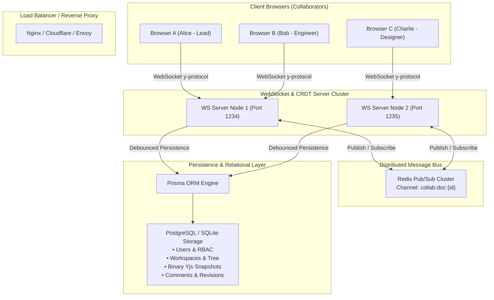
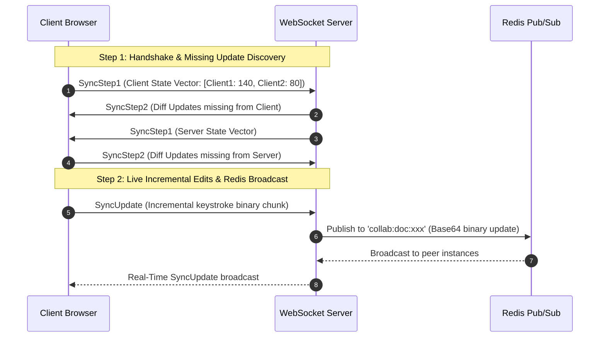
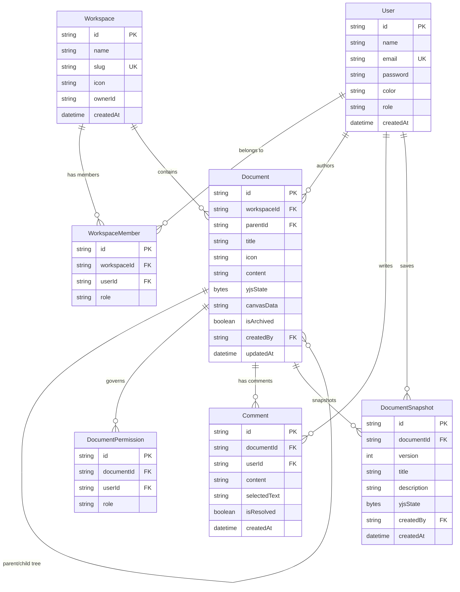

# SyncSpace System Architecture & Technical Specification

SyncSpace is a distributed, real-time collaborative workspace combining **Notion-style structured block editing** and **Figma-style infinite visual canvas diagramming**. This document details the architectural decisions, mathematical CRDT models, WebSocket protocol, Redis horizontal scaling topology, and database schemas.

---

## 1. High-Level Distributed Architecture



---

## 2. CRDT Foundations vs Operational Transformation (OT)

### 2.1 Why CRDTs over OT?
Traditional collaborative systems (e.g., Google Docs v1) rely on **Operational Transformation (OT)**. OT requires:
1. A **central authority** to establish a global operation sequence ($op_1, op_2, \dots$).
2. Transformation matrices ($T(op_A, op_B)$) that grow exponentially with operation complexity.
3. Network roundtrips before an operation is confirmed, creating typing latency and desync under flaky connections.

SyncSpace implements **Conflict-Free Replicated Data Types (CRDTs)** via **Yjs**:
- **Commutativity:** Operations can be received and applied in any order without changing the final document state:
  $$A \circ B = B \circ A$$
- **Associativity:** Grouping of operations does not affect the outcome:
  $$(A \circ B) \circ C = A \circ (B \circ C)$$
- **Idempotency:** Re-transmitting or duplicate delivery of the same update produces no change:
  $$A \circ A = A$$

### 2.2 Yjs Sequence CRDT Mechanics
Yjs represents a collaborative document as a doubly-linked list of **Items**:
$$\text{Item} = \langle \text{ID}, \text{Left}, \text{Right}, \text{Content}, \text{DeletedFlag} \rangle$$

- **Item ID:** Composed of a unique client identifier and a monotonic logical clock:
  $$\text{ID} = (\text{client\_id}, \text{clock})$$
- **Insertions:** When an item is inserted between item $L$ and item $R$, it records $L$ and $R$ as its immutable left and right origin pointers. Even if another peer inserts concurrently, the deterministic sorting of $(\text{clock}, \text{client\_id})$ guarantees identical ordering across all replicas.
- **Deletions & Garbage Collection:** Deletions do not shift character offsets. Instead, an item is marked with a **tombstone** ($\text{DeletedFlag} = \text{true}$), ensuring that concurrent insertions pointing to the deleted item remain valid.

### 2.3 State Vector Sync Protocol (`y-protocols/sync`)
Instead of transmitting the entire document on every keystroke, SyncSpace utilizes a **2-Step State Vector Handshake**:



---

## 3. Real-Time Presence & Awareness Protocol

Collaborative awareness (colored cursors, live selections, and active user avatars) operates over the binary `y-protocols/awareness` channel:
1. **Local State Broadcast:** Each client periodically broadcasts an awareness dictionary:
   ```json
   {
     "user": {
       "id": "usr_alice_01",
       "name": "Alice Cooper",
       "color": "#3b82f6",
       "avatar": "https://...",
       "role": "ADMIN"
     },
     "cursor": { "x": 420, "y": 180 },
     "selection": { "from": 12, "to": 28 }
   }
   ```
2. **Ephemeral Nature:** Unlike document CRDT updates, awareness states are **ephemeral** and not persisted to disk. If a client disconnects, a heartbeat timeout (30 seconds) automatically prunes the user from the active collaborator list.

---

## 4. Multi-Instance Horizontal Scaling with Redis Pub/Sub

To scale across multiple WebSocket server instances without session affinity or sticky load-balancing bottlenecks:
1. **Channel Namespacing:** Every document has a dedicated Redis channel:
   $$\text{Channel} = \text{"collab:doc:"} + \text{documentId}$$
2. **Loop Prevention:** When a server instance applies an update received from Redis, it tags the update origin as `'redis'`. The local document update handler checks:
   $$\text{if } (\text{origin} \neq \text{'redis'} \land \text{origin} \neq \text{'database-init'}) \implies \text{publishToRedis()}$$
   This completely prevents infinite pub/sub echo storms.
3. **Graceful Zero-Config Fallback:** If Redis is temporarily offline, the `RedisSyncBus` automatically downgrades to an in-memory Node.js `EventEmitter`, allowing zero-friction local development without requiring external daemons.

---

## 5. Database Schema & Entity-Relationship Model



---

## 6. Granular Access Control & Version History Revert

### 6.1 Permission Matrix
- **`EDIT` (Full Access):** User can insert/delete blocks, modify formatting, create/move canvas notes, resolve comments, and save snapshots.
- **`COMMENT` (Reviewer):** TipTap editor is set to read-only (`editor.setEditable(false)`). User can select text and submit threaded discussion comments.
- **`VIEW` (Observer):** Strict read-only mode for both document and canvas.

### 6.2 Version Snapshot & Rollback Engine
1. **Snapshot Creation:** An immutable row is created in `DocumentSnapshot` recording the current `version`, author, summary, and binary `Y.encodeStateAsUpdate(ydoc)`.
2. **1-Click Rollback:** When restoring an older version, the server:
   - Updates the database row with the historical state.
   - Applies the historical binary update to the active in-memory `Y.Doc`.
   - Broadcasts the rollback update across Redis Pub/Sub, immediately rewinding the active text for all currently connected browser peers in real time!
